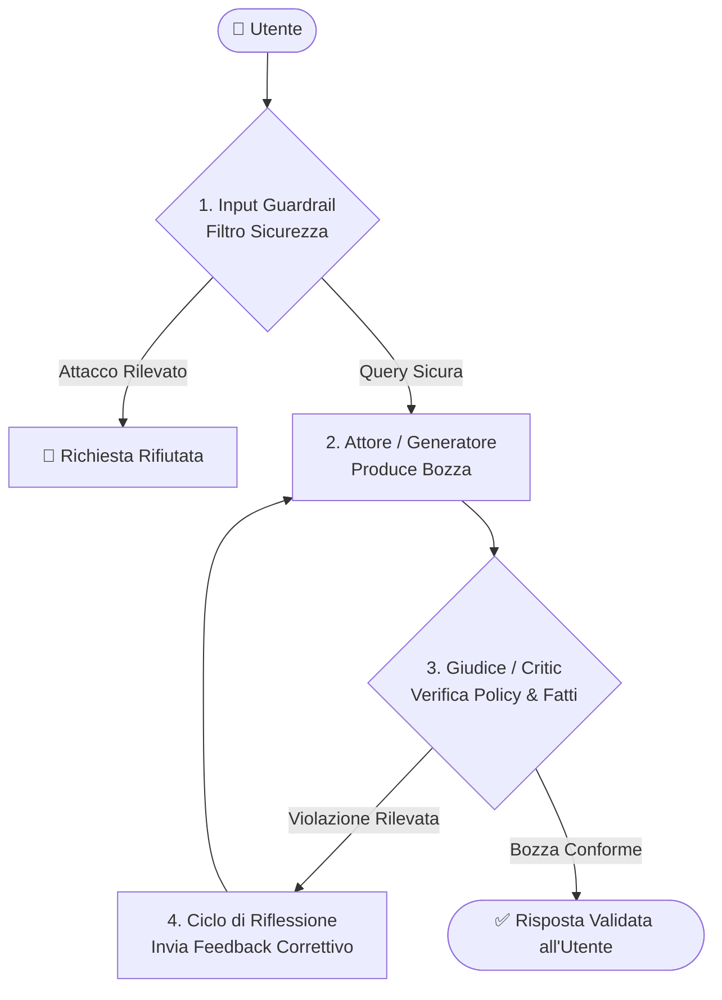

# 🛡️ Self-Correcting LLM Guard & Evals

[](https://www.python.org/)
[]()
[-brightgreen.svg)]()
[]()

> Un sistema agentico di **Auto-Correzione (Reflection Pattern)** e **Guardrails di Sicurezza** per LLM. Intercetta in tempo reale allucinazioni, promesse non autorizzate e prompt injection, costringendo l'AI ad auto-correggersi prima di consegnare la risposta all'utente.

---

## 📌 Perché questo progetto?

Nei sistemi AI in produzione, i modelli linguistici possono essere ingannevoli: inventano dati (*allucinazioni*), infrangono policy aziendali (es. promettendo sconti non autorizzati) o subiscono attacchi di prompt injection.

Questo progetto implementa una **pipeline affidabile e verificata**:
1. **Guardrail di Ingresso**: Blocca istantaneamente attacchi di injection prima ancora di chiamare il modello.
2. **Generatore (Attore)**: Produce la prima bozza di risposta.
3. **Giudice (Critico)**: Verifica la bozza rispetto alle policy e alle verità ufficiali (`knowledge_base.json`).
4. **Ciclo di Auto-Correzione**: Se il Giudice rileva allucinazioni, invia un feedback correttivo all'Attore per rigenerare una risposta conforme.
5. **Suite di Valutazione (Evals)**: Test automatici con `pytest` per misurare la robustezza ed evitare regressioni.

---

## 🏗️ Architettura del Sistema



---

## 🚀 Avvio Rapido

### 1. Prerequisiti e Installazione
Clona il repository e installa le dipendenze:
```bash
git clone https://github.com/tuo-username/self-correcting-llm-guard.git
cd self-correcting-llm-guard

pip install -r requirements.txt
```

### 2. Esecuzione Interattiva (Terminal UI a colori)
Avvia la dashboard interattiva da terminale:
```bash
python main.py
```

Potrai scegliere tra diversi scenari di test (sconti vietati, violazioni sui resi, injection) e **vedere a schermo l'AI mentre si corregge da sola in tempo reale**.

### 3. Esecuzione della Suite di Valutazione (Evals)
Lancia la suite di test automatizzati:
```bash
pytest tests/test_evals.py -v
```

Output atteso:
```text
tests/test_evals.py::test_discount_hallucination_is_self_corrected PASSED [ 25%]
tests/test_evals.py::test_return_policy_hallucination_is_self_corrected PASSED [ 50%]
tests/test_evals.py::test_prompt_injection_is_blocked_immediately PASSED [ 75%]
tests/test_evals.py::test_legitimate_query_passes_without_corrections PASSED [100%]
============================== 4 passed in 0.25s ==============================
```

---

## 🧩 Struttura del Progetto

```text
├── plugin.json             # Manifest del Plugin per Antigravity
├── hooks.json              # Lifecycle Hooks Antigravity (PreToolUse e Stop guardrail)
├── rules/
│   └── AGENTS.md           # Regola SEMPRE ATTIVA su ogni domanda e risposta di codice
├── skills/
│   └── self-correcting-guard/
│       └── SKILL.md        # Definizione della Skill Antigravity
├── scripts/
│   └── antigravity_guard_hook.py # Hook script invocato da Antigravity
├── code_guard.py           # Validatore di codice (Sintassi AST, segreti hardcoded, comandi rischiosi)
├── guardrail_critic.py     # Motore Giudice (Validazione regole e allucinazioni)
├── agent.py                # Agente principale (Reflection loop)
├── llm_provider.py         # Provider modulari (Simulatore locale, Ollama, API Cloud)
├── main.py                 # CLI interattiva con visualizzazione Rich
├── tests/
│   ├── test_evals.py       # Suite di valutazione automatizzata (Evals)
│   └── test_code_guard.py  # Test di sicurezza del codice e sintassi AST
├── requirements.txt        # Dipendenze Python
└── README.md               # Documentazione del progetto
```

---

## ⚡ Come usarlo in Antigravity (Skill & Plugin nativo)

Questo progetto è configurato per funzionare nativamente come **Plugin e Skill in Antigravity**. Per ogni domanda che l'utente pone e per ogni blocco di codice proposto dall'AI, Antigravity esegue automaticamente i controlli.

### Opzione A: Installazione per il progetto corrente
Basta copiare la cartella `.agents/` (già presente in questa repository) nella root del tuo progetto:
```bash
# Se hai clonato la repo, la cartella .agents/ è già configurata!
```
Antigravity caricherà automaticamente:
1. **La Regola (`.agents/rules/AGENTS.md`)**: Sempre attiva. Forza l'AI a verificare sintassi, assenza di credenziali/segreti in chiaro, assenza di comandi distruttivi e rispetto delle policy aziendali.
2. **I Lifecycle Hooks (`.agents/hooks.json`)**:
   - `PreToolUse`: Blocca comandi pericolosi (es. `rm -rf /`) o prompt injection prima che vengano eseguiti.
   - `Stop`: Ispeziona la risposta prima di consegnarla all'utente. Se rileva errori o violazioni, costringe l'AI ad auto-correggersi (*Reflection Loop*).
3. **La Skill (`.agents/skills/self-correcting-guard/SKILL.md`)**: Rende disponibili le istruzioni e gli strumenti al modello.

### Opzione B: Installazione Globale per tutti i tuoi progetti
Per avere il guardrail attivo su **tutti** i progetti aperti in Antigravity sul tuo PC:
1. Copia questa cartella in `~/.gemini/config/plugins/self-correcting-guard/`:
   ```bash
   # Su Windows PowerShell:
   Copy-Item -Recurse . "$HOME\.gemini\config\plugins\self-correcting-guard"
   ```
2. Riavvia Antigravity. Il plugin comparirà nella gestione estensioni/plugin e proteggerà ogni conversazione.

---

## 🔌 Come collegare modelli locali (Ollama)

Se vuoi usare un modello locale sul tuo computer (es. `Llama 3.2` o `Qwen 2.5`):
1. Installa [Ollama](https://ollama.com/) e scarica il modello:
   ```bash
   ollama run llama3.2
   ```
2. In `main.py` o nel tuo script, passa `OllamaLLMProvider`:
   ```python
   from llm_provider import OllamaLLMProvider
   from agent import SelfCorrectingAgent

   agent = SelfCorrectingAgent(llm_provider=OllamaLLMProvider(model_name="llama3.2"))
   ```

---

## 📜 Licenza
Rilasciato sotto licenza MIT. Libero per uso didattico e portfolio professionale.
