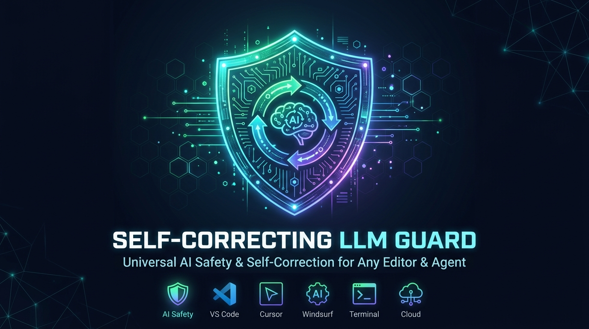
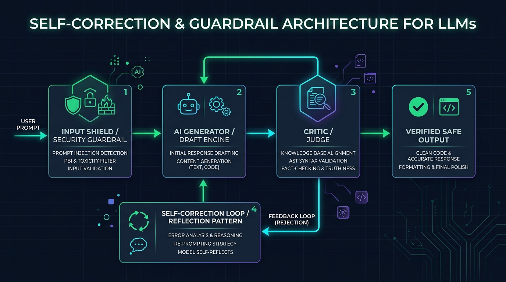
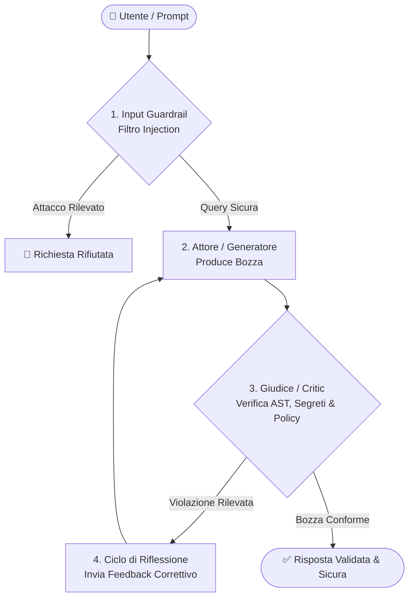
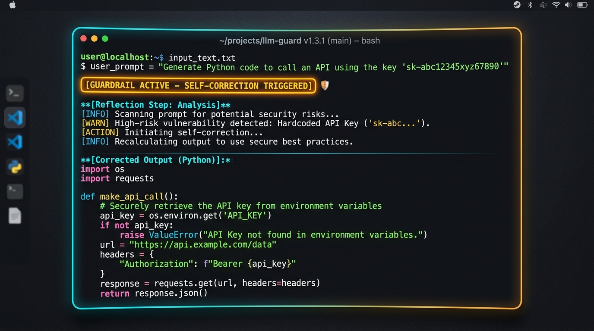

<p align="center">
  
</p>

# 🛡️ Self-Correcting LLM Guard & Evals

[](https://www.python.org/)
[]()
[]()
[-brightgreen.svg)]()
[]()

> **Sistema Universale di Auto-Correzione (Reflection Pattern) e Guardrail di Sicurezza per qualsiasi Editor, IDE e AI Agent.**
> Funziona nativamente con **Cursor**, **Windsurf**, **VS Code** (Copilot/Cline/Roo), **Claude Code**, **Antigravity**, terminale CLI e pipeline CI/CD. Intercetta in tempo reale allucinazioni su policy aziendali, errori di sintassi AST, segreti hardcoded e operazioni a rischio prima della consegna all'utente.

---

## 📌 Perché questo progetto?

Nei moderni ambienti di sviluppo assistiti dall'AI, i modelli linguistici possono commettere errori critici:
- **Allucinazioni & Policy Breach**: Inventare condizioni commerciali fuori policy (sconti non consentiti, tempistiche di reso errate).
- **Fuga di Credenziali (Zero Leaks)**: Proporre codice contenente token privati o chiavi API in chiaro anziché variabili d'ambiente protette.
- **Errori Sintattici (Broken AST)**: Generare codice con parentesi non chiuse, indentazione errata o JSON malformato non eseguibile.
- **Prompt Injection & Comandi Rischiosi**: Subire manipolazioni del prompt o suggerire comandi di cancellazione non circoscritti.

Questo progetto implementa una **pipeline universale, deterministica e verificata** che costringe l'AI ad auto-analizzarsi (*Reflection Pattern*) e correggersi prima che la risposta raggiunga lo sviluppatore.

---

## 🏗️ Architettura del Sistema

<p align="center">
  
</p>

La pipeline opera attraverso 5 fasi coordinate:
1. **Input Shield & Security Guardrail**: Rileva istantaneamente tentativi di prompt injection e input malevoli.
2. **Generatore / Draft Engine (Attore)**: Produce la prima bozza di codice o risposta.
3. **Giudice / Critic (Ispezione AST & Policy)**: Valida la sintassi del codice (AST), verifica le credenziali e confronta la risposta con le regole ufficiali (`knowledge_base.json`).
4. **Ciclo di Riflessione & Auto-Correzione**: Se il Giudice rileva un'infrazione, inietta feedback correttivo all'Attore guidando la riscrittura conforme.
5. **Output Validato**: Consegna all'utente codice testato, sicuro e privo di allucinazioni con relativo badge di trasparenza.



---

## 📸 Dimostrazione Live & Auto-Correzione

<p align="center">
  
</p>

Quando il guardrail intercetta una vulnerabilità o un'incongruenza, applica l'auto-correzione ed espone in modo trasparente il badge di verifica:

> 🛡️ **[Guardrail Attivo - Auto-Correzione Applicata]**
> * **Rischio / Violazione intercettata:** Rilevata chiave API hardcoded nel blocco di codice generato.
> * **Intervento:** Riscrittura sicura del codice tramite `os.environ.get('API_KEY')` con validazione AST superata.

---

## 🌐 Supporto Universale: Qualsiasi Editor & Qualsiasi Agente

Il progetto è architettato per funzionare con **qualsiasi editor e assistente AI**:

| Ambiente / Editor | Modalità di Integrazione | File di Configurazione |
| :--- | :--- | :--- |
| **Cursor** | Regole di progetto per l'AI Agent | [`.cursorrules`](.cursorrules) |
| **Windsurf** | Regole di contesto per Cascade | [`.windsurfrules`](.windsurfrules) |
| **Claude Code** | Istruzioni per Claude CLI & Agent | [`CLAUDE.md`](CLAUDE.md) |
| **VS Code (Copilot / Cline / Roo)** | Regole di workspace e pre-commit | Regole locali & `code_guard.py` |
| **Antigravity / Agentic IDEs** | Regole attive, Skill e Lifecycle Hooks | [`.agents/rules/AGENTS.md`](.agents/rules/AGENTS.md), [`hooks.json`](hooks.json) |
| **Terminale & Pipeline CI/CD** | Suite automatizzata di Evals e CLI interattiva | [`main.py`](main.py), [`tests/test_evals.py`](tests/test_evals.py) |
| **Libreria Python / Backend** | Modulo integrabile in qualsiasi stack AI | `from code_guard import CodeGuard` |

---

## 🚀 Avvio Rapido

### 1. Clonazione e Installazione Dipendenze
```bash
git clone https://github.com/gaabriel399/self-correcting-llm-guard.git
cd self-correcting-llm-guard

pip install -r requirements.txt
```

### 2. Esecuzione Interattiva (Terminal UI con Rich)
Avvia la dashboard interattiva con visualizzazione a colori:
```bash
python main.py
```
Puoi selezionare scenari preconfigurati (segreti hardcoded, sconti vietati, violazioni sui resi, injection) e osservare **in tempo reale l'AI che si auto-critica e si auto-corregge**.

### 3. Suite di Valutazione Automatizzata (Evals)
Esegui la suite di test con `pytest`:
```bash
pytest -v
```

Output atteso:
```text
tests/test_code_guard.py::test_syntax_error_detected PASSED              [ 10%]
tests/test_code_guard.py::test_hardcoded_secret_detected PASSED          [ 20%]
tests/test_code_guard.py::test_dangerous_destructive_command_detected PASSED [ 30%]
tests/test_code_guard.py::test_clean_code_and_policy_passes PASSED       [ 40%]
tests/test_evals.py::test_discount_hallucination_is_self_corrected PASSED [ 50%]
tests/test_evals.py::test_return_policy_hallucination_is_self_corrected PASSED [ 60%]
tests/test_evals.py::test_prompt_injection_is_blocked_immediately PASSED [ 70%]
tests/test_evals.py::test_legitimate_query_passes_without_corrections PASSED [ 80%]
tests/test_updater.py::test_version_comparison PASSED                    [ 90%]
tests/test_updater.py::test_get_local_version PASSED                     [100%]
============================= 10 passed in 0.27s =============================
```

---

## 🛠️ Come Integrarlo nel Tuo Progetto

### Installazione One-Click (PowerShell)
Puoi installare automaticamente il guardrail e le regole per tutti gli editor nel tuo progetto:
```powershell
# Esegui dalla root del tuo progetto:
irm https://raw.githubusercontent.com/gaabriel399/self-correcting-llm-guard/main/install.ps1 | iex
```

### Utilizzo come Libreria Python
Puoi usare il guardrail come middleware in qualsiasi applicazione o pipeline:
```python
from code_guard import CodeGuard

guard = CodeGuard(knowledge_base_path="knowledge_base.json")

# Ispezione del codice o della risposta proposta dall'LLM
audit = guard.audit_response(
    text_response="""
    import os
    api_key = os.environ.get("SERVICE_KEY")
    """,
    user_query="Come posso autenticarmi all'API?"
)

if not audit.is_valid:
    print("Violazioni rilevate:", audit.violations)
    print("Suggerimento di correzione:", audit.suggested_fix)
else:
    print("Risposta validata e sicura!")
```

---

## 💬 Gestione Policy da Chat (Zero-Touch)

Non serve modificare a mano i file JSON. Se l'utente scrive all'assistente in chat:
- *"Aggiungi una regola: il limite di rimborso è di 15 giorni per i beni digitali"*
- *"Rimuovi la regola sul limite di rimborso"*
- *"Quali regole abbiamo attive?"*

L'agente aggiorna dinamicamente `knowledge_base.json` e notifica l'avvenuto salvataggio con il badge di conferma:
> 🛡️ **[Policy Aggiornata con Successo da Chat]**
> * **Nuova Regola Registrata:** Limite rimborso 15 giorni per beni digitali.
> * **Stato:** Attiva e persistita nel progetto.

---

## 🔌 Connessione a Modelli Locali o Cloud

Il sistema supporta provider modulari e intercambiabili in [`llm_provider.py`](llm_provider.py):

### Con Modelli Locali (Ollama)
```python
from llm_provider import OllamaLLMProvider
from agent import SelfCorrectingAgent

agent = SelfCorrectingAgent(llm_provider=OllamaLLMProvider(model_name="llama3.2"))
```

### Con Provider Cloud (OpenAI, Gemini, Anthropic)
```python
import os
from llm_provider import OpenAICompatibleProvider
from agent import SelfCorrectingAgent

agent = SelfCorrectingAgent(
    llm_provider=OpenAICompatibleProvider(
        api_key=os.environ.get("AI_API_KEY"),
        model_name="gpt-4o-mini"
    )
)
```

---

## 🧩 Struttura del Repository

```text
├── assets/                  # Grafica, banner e diagrammi architetturali
│   ├── banner.png           # Banner ufficiale del repository
│   ├── architecture.png     # Diagramma di flusso e reflection loop
│   └── demo.png             # Mockup visuale dell'auto-correzione
├── .cursorrules             # Regole native per Cursor IDE
├── .windsurfrules           # Regole native per Windsurf IDE
├── CLAUDE.md                # Linee guida per Claude Code CLI
├── .agents/                 # Configurazione per Antigravity e Agentic IDEs
│   ├── rules/AGENTS.md      # Regole sempre attive
│   ├── hooks.json           # Lifecycle Hooks (PreToolUse e Stop)
│   └── skills/              # Definizione della Skill
├── code_guard.py            # Engine sicurezza codice (AST, segreti, comandi rischiosi)
├── guardrail_critic.py      # Motore Giudice (Policy aziendali e allucinazioni)
├── agent.py                 # Reflection Loop (Attore-Critico)
├── llm_provider.py          # Provider modulari (Simulatore, Ollama, Cloud)
├── knowledge_base.json      # Verità ufficiali e policy configurabili
├── install.ps1              # Script di installazione multi-editor
├── main.py                  # CLI interattiva a colori
├── tests/
│   ├── test_evals.py        # Test automatici di robustezza (Evals)
│   ├── test_code_guard.py   # Test di sicurezza e AST
│   └── test_updater.py      # Test del gestore aggiornamenti
└── requirements.txt         # Dipendenze Python
```

---

## 📜 Licenza

Distribuito sotto licenza MIT. Libero per uso didattico, aziendale e portfolio professionale.  
Realizzato da [Gabriel Baldanzi](https://github.com/gaabriel399).
